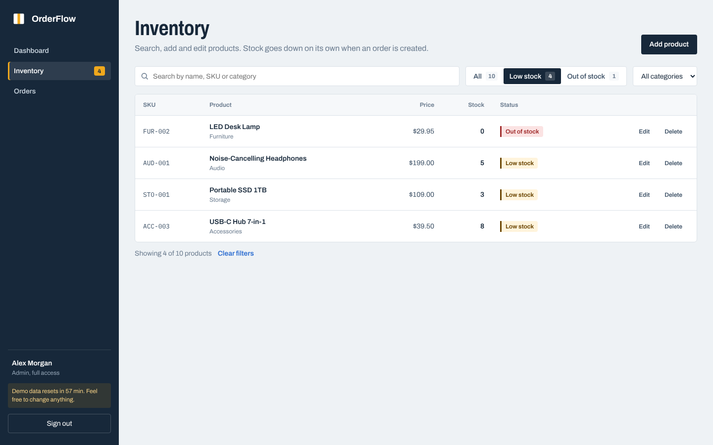

# OrderFlow: Inventory & Order Management Dashboard


Full-stack app to manage products, stock and customer orders, with role-based access and a KPI dashboard.


| Inventory                        | Orders                     |
| -------------------------------- | -------------------------- |
|  |  |

## Features

- **Dashboard:** revenue, pending orders, low-stock alerts, orders by status and recent orders.
- **Inventory:** live search, stock and category filters, color-coded stock badges and a modal to add or edit products.
- **Orders:** status filters, a dropdown to update shipping status, and a form to create orders with several products.
- **Roles:** `admin` can change data, `viewer` is read only. The UI hides what you can't do and the API enforces it.

## Tech stack

| Layer    | Tools                                                                    |
| -------- | ------------------------------------------------------------------------ |
| Frontend | Next.js 16 (App Router), React 19, Redux Toolkit, Sass modules           |
| Backend  | Node.js 22, Express 5, MySQL 8 (`mysql2/promise`), JWT, bcrypt           |
| Quality  | 45 API tests (`node:test` + Supertest), ESLint, Prettier, GitHub Actions |
| DevOps   | Docker Compose (MySQL + API), health check endpoint                      |

JavaScript ES6+ only, no TypeScript.

## Technical highlights

- **No overselling.** Creating an order runs in one SQL transaction with `SELECT ... FOR UPDATE`. If any product is short on stock, everything rolls back. A test sends two orders in parallel to prove it.
- **Order history stays correct.** Each order line saves the product name and price at purchase time.
- **Status rules.** `Pending -> Shipped -> Delivered`. Only pending orders can be cancelled, and cancelling returns the stock.
- **Optimistic UI.** Status changes show right away and roll back if the API rejects them.
- **Clear errors.** Input is validated against the database limits, so bad data gets a `400` with field details, never a `500`.
- **Demo that can't be broken.** With `DEMO_MODE=true` the API restores the seed data on a fixed interval.

## Getting started

Requirements: Node.js 22+ and Docker (or a local MySQL 8).

```bash
# 1. Database + API (schema and seed data load automatically)
docker compose up -d

# 2. Frontend
cd frontend
npm install
cp .env.example .env.local
npm run dev
```

Open http://localhost:3000 and click "Demo Access (Admin)".

Without Docker: create a MySQL database, copy `backend/.env.example` to `backend/.env` with your credentials, and run `npm install`, `npm run db:setup` and `npm run dev` inside `backend/`.

| Role   | Email                  | Password     |
| ------ | ---------------------- | ------------ |
| admin  | `admin@orderflow.dev`  | `Admin123!`  |
| viewer | `viewer@orderflow.dev` | `Viewer123!` |

## API

All routes start with `/api`. Every route except login and health needs a `Bearer` token.

| Method | Endpoint             | Access | Description                        |
| ------ | -------------------- | ------ | ---------------------------------- |
| POST   | `/auth/login`        | Public | Returns a JWT and the user role    |
| GET    | `/dashboard/stats`   | Any    | Revenue, pending orders, low stock |
| GET    | `/products`          | Any    | List, with `search` and filters    |
| POST   | `/products`          | Admin  | Create a product                   |
| PATCH  | `/products/:id`      | Admin  | Update stock, price or details     |
| DELETE | `/products/:id`      | Admin  | Delete a product                   |
| GET    | `/orders`            | Any    | List, with `?status=` filter       |
| POST   | `/orders`            | Admin  | Create an order and deduct stock   |
| PATCH  | `/orders/:id/status` | Admin  | Update the order status            |

More examples in `backend/api.http`.

## Project structure

```
orderflow/
├── backend/     Express API: routes, controllers, middlewares, SQL files, tests
├── frontend/    Next.js app: pages, components, Redux slices, Sass styles
├── docs/        Screenshots
└── docker-compose.yml
```

## Testing

Tests run against a separate database whose name ends with `_test`. Copy `backend/.env` to `backend/.env.test`, set `DB_NAME=orderflow_test`, and run:

```bash
cd backend
npm test
```

## Deployment

- **Database:** any hosted MySQL 8 (Railway, Aiven). Run `npm run db:setup` once.
- **API:** Render or Railway. Set `DEMO_MODE=true` and `CORS_ORIGIN` to the frontend URL.
- **Frontend:** Vercel, with root directory `frontend` and `NEXT_PUBLIC_API_URL` pointing to the API.

## License

MIT
