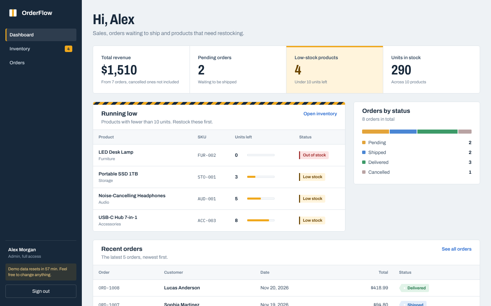
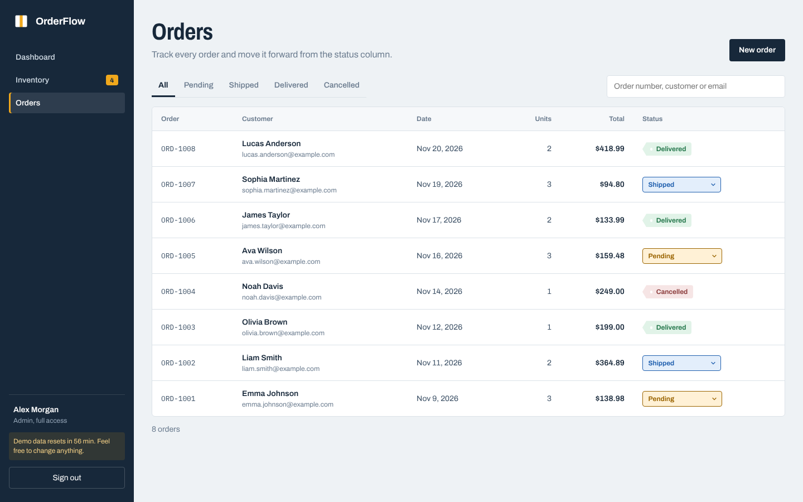

# OrderFlow - Inventory & Order Management Dashboard


Full-stack app to manage products, stock and customer orders, with role-based access and a live KPI dashboard.

**Live demo:** [YOUR_FRONTEND_URL](https://YOUR_FRONTEND_URL) (click "Demo Access (Admin)", no sign-up needed)
**API:** [YOUR_API_URL/api/health](https://YOUR_API_URL/api/health)

> Demo data is restored automatically every 60 minutes, so feel free to create, edit and delete anything.



| Inventory | Orders |
| --------- | ------ |
|  |  |

---

## Features

- **Dashboard:** KPI summary (revenue, pending orders, low-stock count, units in stock), a low-stock alert table, orders by status and recent orders.
- **Inventory:** product table with live search, stock and category filters, color-coded stock badges and a modal to add or edit products.
- **Orders:** status filters, search, a dropdown to move each order forward and a form to create orders with several products.
- **Roles:** `admin` can change data, `viewer` has read-only access. The UI hides actions the user is not allowed to do, and the API enforces it.
- **One-click demo:** "Demo Access (Admin)" on the login page, no sign-up needed.

## Tech stack

| Layer    | Tools                                                                      |
| -------- | -------------------------------------------------------------------------- |
| Backend  | Node.js 22, Express 5, MySQL 8 (`mysql2/promise`), JWT, bcrypt             |
| Security | Helmet, CORS allowlist, login rate limiting, role middleware               |
| Frontend | Next.js 16 (App Router), React 19, Redux Toolkit, Sass modules             |
| Quality  | 45 API tests (`node:test` + Supertest), ESLint, Prettier, CI for both apps |
| DevOps   | Dockerfile, Docker Compose (MySQL + API), health check with DB status     |

JavaScript ES6+ only, no TypeScript.

## Technical highlights

- **Safe stock handling.** Creating an order runs in one SQL transaction. Product rows are locked with `SELECT ... FOR UPDATE` so two orders at the same time cannot sell the same last units. If anything fails, the whole operation is rolled back. There is a test that sends two competing orders in parallel and checks that only one succeeds.
- **Order status rules.** Status changes follow a fixed flow (`Pending -> Shipped -> Delivered`, and only `Pending` orders can be cancelled). Invalid changes return `409`, and cancelling an order returns its items to stock.
- **Order history stays correct.** Each order line stores the product name and unit price at the time of purchase, so editing or deleting a product never changes past orders.
- **Input validated before it reaches the database.** Text lengths and number ranges match the column sizes in `schema.sql`, so bad input always gets a clear `400` with field details instead of a `500`. Search terms are escaped, so `%` and `_` are treated as plain text.
- **Clean layered structure.** Routes, middlewares, controllers and utils are separated. Errors go through a single handler that maps MySQL errors to proper HTTP codes and hides internal details in production.
- **Optimistic status updates.** Changing an order status in the UI updates the row right away. If the API rejects the change, Redux puts the previous status back and a message explains why.
- **Live search without extra requests.** Product search and filters run on memoized Redux selectors (`createSelector`), so results update on every keystroke. Order status filters use the API, and late responses from an older filter are ignored.
- **Session handling.** The token expiry is checked when the app loads, and any `401` from the API ends the session and sends the user back to the login page with a clear message.
- **Accessible UI without a component library.** Modals use the native `<dialog>` element (focus trap and Esc for free), forms link errors to their fields, and the layout works from 390px phones to wide screens.
- **Public demo that can't be broken.** With `DEMO_MODE=true` the API reloads the seed data on a fixed interval, and `GET /api/health` tells the frontend when the next reset happens.

---

## Repository structure

```
orderflow/
├── .github/workflows/
│   ├── backend-ci.yml                # Lint, format check and tests on MySQL 8
│   └── frontend-ci.yml               # Lint, format check and production build
├── docs/                             # Screenshots used in this README
├── docker-compose.yml                # MySQL (schema + seed loaded) + API
├── backend/
│   ├── Dockerfile                    # Production image (non-root, health check)
│   ├── eslint.config.js              # ESLint flat config
│   ├── api.http                      # Ready-to-run request collection
│   ├── database/
│   │   ├── schema.sql                # Tables, keys, constraints
│   │   └── seed.sql                  # 2 users, 10 products, 8 orders
│   ├── scripts/db.js                 # npm run db:setup / db:seed
│   ├── src/
│   │   ├── server.js                 # Boot, DB check, graceful shutdown
│   │   ├── app.js                    # Express app, security, routes, errors
│   │   ├── config/                   # env validation, MySQL pool + transactions
│   │   ├── middlewares/              # auth (JWT), roles, rate limit, errors
│   │   ├── controllers/              # auth, dashboard, products, orders
│   │   ├── routes/                   # Everything mounted under /api
│   │   ├── jobs/demoReset.job.js     # Demo data reset
│   │   └── utils/                    # AppError, validators, SQL runner
│   └── tests/                        # Integration + unit tests
└── frontend/
    ├── next.config.mjs               # Sass load path for the shared variables
    └── src/
        ├── app/                      # App Router: /login, (app)/dashboard, inventory, orders
        ├── components/
        │   ├── layout/               # App shell, sidebar, auth guard
        │   ├── ui/                   # Button, Modal, Field, badges, toasts, table styles
        │   ├── auth/ dashboard/ inventory/ orders/
        ├── store/
        │   ├── index.js              # makeStore()
        │   └── slices/               # authSlice, inventorySlice, ordersSlice
        ├── hooks/                    # useDashboardStats, useDemoStatus
        ├── lib/                      # API client, session, formatters, status rules
        └── styles/                   # _variables.scss, _mixins.scss, globals.scss
```

---

## Getting started

Requirements: **Node.js 22+** and either **Docker** or a local **MySQL 8**.

### 1. Start MySQL

**Option A: Docker (recommended)**

```bash
docker compose up -d           # MySQL + API, nothing else to install
docker compose up -d mysql     # only MySQL, if you want to run the API with npm
```

This creates the `orderflow` database and loads the schema and seed data automatically. With the first command the API is already running on `http://localhost:4000/api`, so you can skip steps 2 to 4.

**Option B: local MySQL**

Create an empty database (for example `orderflow`) and a user with access to it. Tables and data are created in step 3.

### 2. Configure the backend

```bash
cd backend
npm install
cp .env.example .env
```

The default values in `.env.example` already match the Docker setup. For production, set a strong `JWT_SECRET` (`openssl rand -hex 32`).

### 3. Load the database (Option B only)

```bash
npm run db:setup
```

### 4. Run the API

```bash
npm run dev
```

The API runs on `http://localhost:4000/api`. Try `GET /api/health` or open `api.http`.

### 5. Run the frontend

In a second terminal:

```bash
cd frontend
npm install
cp .env.example .env.local
npm run dev
```

Open `http://localhost:3000` and click "Demo Access (Admin)". The default `NEXT_PUBLIC_API_URL` points to the local API.

### Demo credentials

| Role   | Email                  | Password     |
| ------ | ---------------------- | ------------ |
| admin  | `admin@orderflow.dev`  | `Admin123!`  |
| viewer | `viewer@orderflow.dev` | `Viewer123!` |

### Backend scripts

| Command                       | What it does                                         |
| ----------------------------- | ---------------------------------------------------- |
| `npm run dev`                 | Start the API in watch mode                          |
| `npm start`                   | Start the API                                        |
| `npm test`                    | Run all tests (needs a `_test` database, see below)  |
| `npm run lint`                | Check the code with ESLint                           |
| `npm run format`              | Format the code with Prettier                        |
| `npm run db:setup`            | Drop and create all tables, then load the seed       |
| `npm run db:seed`             | Reload the seed data only                            |
| `npm run db:hash -- "Pass1!"` | Generate a bcrypt hash for a new password            |

### Frontend scripts

| Command          | What it does                       |
| ---------------- | ---------------------------------- |
| `npm run dev`    | Start Next.js in development mode  |
| `npm run build`  | Create the production build        |
| `npm start`      | Serve the production build         |
| `npm run lint`   | Check the code with ESLint         |
| `npm run format` | Format the code with Prettier      |

### Backend environment variables

| Variable                      | Description                                   | Default                 |
| ----------------------------- | --------------------------------------------- | ----------------------- |
| `PORT`                        | API port                                      | `4000`                  |
| `CORS_ORIGIN`                 | Allowed frontend origins, comma separated     | `http://localhost:3000` |
| `DB_HOST` / `DB_PORT`         | MySQL host and port                           | (required) / `3306`     |
| `DB_USER` / `DB_PASSWORD`     | MySQL credentials                             | (required) / empty      |
| `DB_NAME`                     | Database name                                 | (required)              |
| `JWT_SECRET`                  | Secret used to sign tokens                    | (required)              |
| `JWT_EXPIRES_IN`              | Token lifetime                                | `8h`                    |
| `LOW_STOCK_THRESHOLD`         | Products below this value count as low stock  | `10`                    |
| `LOGIN_RATE_LIMIT`            | Failed logins allowed per IP every 15 minutes | `10`                    |
| `DEMO_MODE`                   | Reload seed data on a fixed interval          | `false`                 |
| `DEMO_RESET_INTERVAL_MINUTES` | Minutes between demo resets                   | `60`                    |

### Frontend environment variables

| Variable                           | Description                              | Default                     |
| ---------------------------------- | ---------------------------------------- | --------------------------- |
| `NEXT_PUBLIC_API_URL`              | API base URL, including `/api`           | `http://localhost:4000/api` |
| `NEXT_PUBLIC_DEMO_ADMIN_EMAIL`     | Account used by "Demo Access (Admin)"    | `admin@orderflow.dev`       |
| `NEXT_PUBLIC_DEMO_ADMIN_PASSWORD`  | Password for that account                | `Admin123!`                 |
| `NEXT_PUBLIC_DEMO_VIEWER_EMAIL`    | Account used by the viewer demo link     | `viewer@orderflow.dev`      |
| `NEXT_PUBLIC_DEMO_VIEWER_PASSWORD` | Password for that account                | `Viewer123!`                |

`NEXT_PUBLIC_*` values are added to the browser bundle at build time, so they must never hold real secrets. The demo accounts are public on purpose.

---

## Testing

Tests run against a real MySQL database to cover transactions and locks. To protect your data, they only run on a database whose name ends with `_test`.

```bash
# Create the test database once (Docker example)
docker exec -it orderflow-mysql mysql -uroot -proot \
  -e "CREATE DATABASE orderflow_test; GRANT ALL ON orderflow_test.* TO 'orderflow'@'%';"

# Point the tests to it
cp .env .env.test   # then set DB_NAME=orderflow_test

npm test
```

The suite covers login and tokens, role permissions, product CRUD and validation limits, search escaping, order creation with stock deduction, rollback on insufficient stock, concurrent orders, status transitions, order deletion rules and dashboard metrics. GitHub Actions runs lint, format check and tests on every push.

---

## API reference

Base URL: `/api`. Every response has the same shape:

```json
{ "success": true, "data": {}, "meta": {} }
{ "success": false, "message": "Error description", "details": {} }
```

Protected routes need the header `Authorization: Bearer <token>`.

### Health

| Method | Endpoint  | Access | Description                                                     |
| ------ | --------- | ------ | --------------------------------------------------------------- |
| GET    | `/health` | Public | API and database status (`503` if MySQL is down) and demo timer |

### Auth

| Method | Endpoint      | Access | Description                                   |
| ------ | ------------- | ------ | --------------------------------------------- |
| POST   | `/auth/login` | Public | Body `{ email, password }`. Returns the token |
| GET    | `/auth/me`    | Any    | Current user (restores the session on reload) |

```json
{
  "success": true,
  "data": {
    "token": "eyJhbGciOi...",
    "role": "admin",
    "user": { "id": 1, "name": "Alex Morgan", "email": "admin@orderflow.dev", "role": "admin" },
    "expiresIn": "8h"
  }
}
```

### Dashboard

| Method | Endpoint           | Access | Description     |
| ------ | ------------------ | ------ | --------------- |
| GET    | `/dashboard/stats` | Any    | Aggregated KPIs |

Returns `totalRevenue` (all orders except Cancelled), `pendingOrders`, `lowStockCount`, `lowStockProducts[]`, `recentOrders[]` (last 5), `ordersByStatus`, `totalOrders`, `totalProducts` and `totalUnitsInStock`.

### Products

| Method      | Endpoint        | Access | Description                       |
| ----------- | --------------- | ------ | --------------------------------- |
| GET         | `/products`     | Any    | List products                     |
| GET         | `/products/:id` | Any    | Product detail                    |
| POST        | `/products`     | Admin  | Create product                    |
| PUT / PATCH | `/products/:id` | Admin  | Partial update (stock, price ...) |
| DELETE      | `/products/:id` | Admin  | Delete product                    |

Query params: `search` (name, SKU or category), `category`, `lowStock=true`, `sortBy` (`name`, `price`, `stock`, `category`, `createdAt`), `order` (`asc` / `desc`).

### Orders

| Method | Endpoint             | Access | Description          |
| ------ | -------------------- | ------ | -------------------- |
| GET    | `/orders`            | Any    | List orders          |
| GET    | `/orders/:id`        | Any    | Order detail + items |
| POST   | `/orders`            | Admin  | Create order         |
| PATCH  | `/orders/:id/status` | Admin  | Update status        |
| DELETE | `/orders/:id`        | Admin  | Delete order         |

Query params: `status` (`Pending`, `Shipped`, `Delivered`, `Cancelled` or `All`), `search` (order number, customer name or email), `limit` (max 200).

```json
{
  "customerName": "Grace Lee",
  "customerEmail": "grace@example.com",
  "items": [
    { "productId": 1, "quantity": 2 },
    { "productId": 4, "quantity": 1 }
  ]
}
```

### Error codes

| Code | Meaning                                                       |
| ---- | ------------------------------------------------------------- |
| 400  | Validation error or malformed JSON                            |
| 401  | Missing, invalid or expired token, or wrong credentials       |
| 403  | Logged in, but the role is not allowed                        |
| 404  | Resource or route not found                                   |
| 409  | Duplicate SKU, not enough stock, or invalid status transition |
| 429  | Too many failed login attempts                                |
| 500  | Unexpected server error (message hidden in production)        |

---

## Business rules

| From      | Allowed to           |
| --------- | -------------------- |
| Pending   | Shipped, Cancelled   |
| Shipped   | Delivered            |
| Delivered | (final)              |
| Cancelled | (final)              |

- Cancelling an order returns its items to stock. A `Shipped` order cannot be cancelled, because the goods already left the warehouse.
- Only `Pending` or `Cancelled` orders can be deleted. Deleting a `Pending` order also returns its stock.
- Input limits: SKU up to 50 characters, product name up to 150, category up to 80, description up to 2000, customer name up to 120. Price from 0 to 999,999.99, stock from 0 to 1,000,000 and up to 1,000 units of each product per order.
- Deleting a product keeps order history: `order_items.product_id` becomes `NULL` and the stored name and price stay the same.

---

## Deployment

- **Database:** any hosted MySQL 8 (Railway, Aiven, etc.). Set the `DB_*` variables and run `npm run db:setup` once from your machine.
- **API:** Render or Railway (Node or Docker). Start command `npm start`, health check path `/api/health`. Set `NODE_ENV=production`, `DEMO_MODE=true` and `CORS_ORIGIN` to the frontend URL.
- **Frontend:** Vercel. Set the root directory to `frontend` and add `NEXT_PUBLIC_API_URL` (for example `https://your-api.onrender.com/api`). The demo account variables are optional, the defaults match the seed data.

## License

[MIT](LICENSE)
